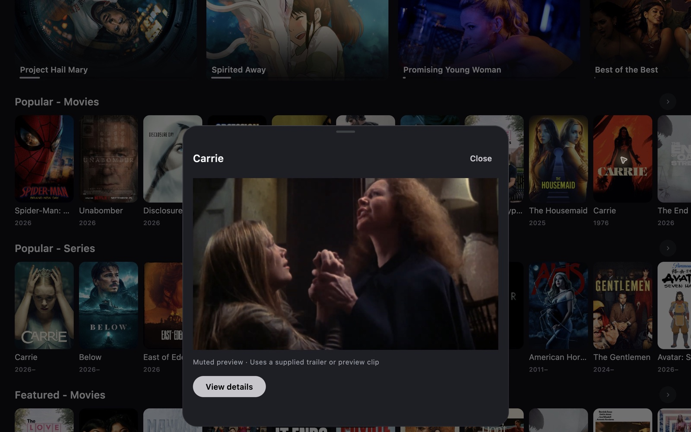

  

<h1 align="center">Mira</h1>

A personal media app with cinematic browsing and a quieter interface.

iPhone · Apple Silicon Mac · Fire TV

  
  

  <a href="#download">Download</a> · <a href="#inside-mira">Inside Mira</a> · <a href="docs/INSTALL.md">Installation</a> · <a href="docs/BUILD-157.md">Latest changes</a>

Real screenshots from the Mac app, build 155. Artwork and available titles depend on your catalogs.

## Download

Latest Mac release: **0.5.12 · build 157**. iPhone and Fire TV remain **0.5.10 · build 155**. These are Release packages; newer iPhone excerpt code is available as preview source only.

| Device | Download | Installation |
| --- | --- | --- |
| iPhone | [IPA](https://github.com/4marawan001/Mira/releases/download/v0.5.10/Mira-ios-155.ipa) | Sign and install with Sideloadly on your Mac. |
| Apple Silicon Mac | [DMG](https://github.com/4marawan001/Mira/releases/download/v0.5.12/Mira-macOS-arm64.dmg) | Open the disk image and copy Mira to Applications. |
| Fire TV | [APK](https://github.com/4marawan001/Mira/releases/download/v0.5.10/Mira-FireTV-universal.apk) | Install on a compatible Android-based Fire TV. Remote controls are supported. |

[All releases and source downloads](https://github.com/4marawan001/Mira/releases) · [Step-by-step setup](docs/INSTALL.md) · [Mac build 157 checksums](https://github.com/4marawan001/Mira/releases/download/v0.5.12/SHA256SUMS.txt)

## Inside Mira

Mira is a personal fork of the open-source Nuvio apps. Home puts artwork first, with genre shortcuts, IMDb Top 250 entry points and compact poster shelves. Home, Search and Saved use a consistent navigation style on iPhone and Mac; TV adapts browsing for the remote.

Search shows results as individual add-ons respond and loads more on demand. Queries stay intact when opening View All and later pages. Duplicate detection and repeated-page protection keep providers from filling the list endlessly. The app has no fixed total-result cap, but results still depend on each provider's search support and available pages.

Playback preferences include Low Data, Balanced and Highest. Balanced favors good 1080p sources for the iPhone 12 mini while reducing the preference for oversized files. Highest favors resolution and disc sources. These choices rank the metadata providers return; they do not measure your internet speed or guarantee playback quality.

### Movies or videos

On iPhone and Mac, open **Settings → Look & feel → Browsing**. Movies & shows is the default. Videos enables muted hover previews on Mac and press-and-hold preview sheets on iPhone. On Mac build 157, a missing trailer falls back to a muted random excerpt lasting up to 30 seconds when an enabled provider exposes a ready direct stream. Short videos may end earlier. The released iPhone IPA still uses supplied trailers or preview clips; the excerpt implementation is preview source only.

### Make it yours

Choose an accent color, change the app icon, or adjust the browsing layout. The silver icon and dark surfaces carry through the app. On iPhone and Mac, the Home logo does a brief dance after ten stationary seconds and respects Reduce Motion.

## What's new in Mac build 157

- Fixes the updater’s installed-app lookup. Install this DMG once if an older build cannot apply its download.
- Automatic update checks on opening and hourly while Mira stays open.
- Automatic downloads with checksum verification, followed by an Install & Restart button. Playback is not interrupted by a completed download.
- Muted random excerpts in Videos mode when no trailer resolves. Preview requests time out and cancel on scrolling or dismissal.
- Less rendering work during scrolling: image crossfades disabled, card highlights cached, and hover scaling suppressed while scrolling.

[Read build 157 changes and checks](docs/BUILD-157.md) · [Earlier build 155 notes](docs/BUILD-155.md).

## Updates

Mac checks for updates on opening and hourly while Mira is running. New packages download automatically and pass a SHA-256 check before **Install & Restart** becomes available. Installation retains the previous app and preserves settings stored outside the app bundle. Checks stop when Mira is closed. Fire TV keeps its existing APK update flow.

The optional [Mira iPhone Updates helper for Mac](https://github.com/4marawan001/Mira/releases/latest/download/Mira-iPhone-Updates-macOS.zip) checks for a newer IPA and hands it to Sideloadly. iPhone signing refresh remains separate from installing new features.

The [update manifest](https://github.com/4marawan001/Mira/releases/latest/download/mira-updates.json) records each platform's version, build, package size and SHA-256 checksum. Platforms can have different current builds.

## Testing status

These are personal testing builds. Mac build 157 passed 30 focused checks, including real installer replacement and rejection checks in temporary folders. The earlier iPhone build 155 passed 102 regression checks, and TV build 155 passed its remote navigation smoke test. Five broader desktop failures remain unresolved. Real-provider excerpt playback and sustained Mac frame rates remain unverified; physical iPhone and Insignia testing is still needed. See [build 157 validation](docs/BUILD-157.md#validation).

The Mac package supports Apple Silicon and is ad-hoc signed. The Fire TV package supports ARMv7 and ARM64 Android/Fire OS devices with Android 7 or later. Platform features differ; Videos mode and the logo dance are excluded from TV.

## Source and credits

Build 155 contains the full source archives, upstream base commits, original licenses and acknowledgements. Build 157 contains verified source patches and base archive checksums, with [reconstruction instructions](updates/157/SOURCE.md). The iPhone patch is preview code, while the Mac patch matches release 157. This repository is the download and documentation hub.

Built on [Nuvio Mobile](https://github.com/NuvioMedia/NuvioMobile), [Nuvio Desktop](https://github.com/NuvioMedia/NuvioDesktop), [Nuvio TV](https://github.com/NuvioMedia/NuvioTV) and [nuvio-engine](https://github.com/NuvioMedia/nuvio-engine).

Mira is a personal fork and is not affiliated with Nuvio or Apple. Release assets exclude saved account data and private signing keys. Media artwork belongs to its respective owners.
