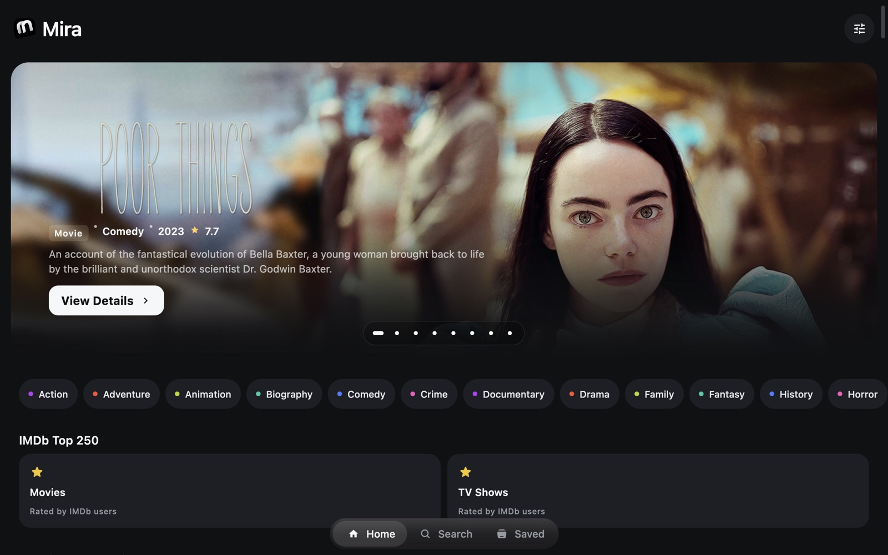

<h1 align="center">Mira</h1>

A media app for Fire TV, Android TV, iPhone, iPad, Mac, and Android phones and tablets.

<a href="#download">Download</a> · <a href="docs/INSTALL.md">Installation</a> · <a href="docs/STATUS.md">Testing status</a> · <a href="docs/README.md">Documentation</a>

## Download

**Fire TV and Android TV:** Open **Downloader by AFTVnews**, enter **`8262801`**, and select **Go**. This code downloads the universal TV APK for **Mira 0.6.2, build 209**. [Downloader link](https://aftv.news/8262801) · [TV installation and compatibility](docs/INSTALL.md#fire-tv-and-android-tv)

| Device | Build | Installer |
| --- | ---: | --- |
| Fire TV / Android TV | 209 | [Universal APK](https://github.com/4marawan001/Mira/releases/download/v0.6.2/Mira-FireTV-209-universal.apk) · [ARMv7](https://github.com/4marawan001/Mira/releases/download/v0.6.2/Mira-FireTV-209-armeabi-v7a.apk) · [ARM64](https://github.com/4marawan001/Mira/releases/download/v0.6.2/Mira-FireTV-209-arm64-v8a.apk) |
| iPhone / iPad | 204 | [Universal IPA](https://github.com/4marawan001/Mira/releases/download/v0.6.2/Mira-iOS-iPadOS-204.ipa) |
| Mac | 203 | [Apple silicon DMG](https://github.com/4marawan001/Mira/releases/download/v0.6.2/Mira-macOS-arm64.dmg) · [Intel DMG](https://github.com/4marawan001/Mira/releases/download/v0.6.2/Mira-macOS-x86_64.dmg) |
| Android phone / tablet | 204 | [ARM64](https://github.com/4marawan001/Mira/releases/download/v0.6.2/Mira-Android-204-arm64-v8a.apk) · [ARMv7](https://github.com/4marawan001/Mira/releases/download/v0.6.2/Mira-Android-204-armeabi-v7a.apk) · [x86](https://github.com/4marawan001/Mira/releases/download/v0.6.2/Mira-Android-204-x86.apk) · [x86_64](https://github.com/4marawan001/Mira/releases/download/v0.6.2/Mira-Android-204-x86_64.apk) |

The IPA requires sideload signing. The Mac DMGs are ad-hoc signed and require macOS 12 or newer. Some apps still show an embedded preview label. If your installed build matches the table, keep it.

[Release notes and assets](https://github.com/4marawan001/Mira/releases/tag/v0.6.2) · [SHA-256 checksums](https://github.com/4marawan001/Mira/releases/download/v0.6.2/SHA256SUMS.txt) · [Update manifest](https://github.com/4marawan001/Mira/releases/latest/download/mira-updates.json)

## Inside Mira

*Mac build 155 screenshot. Catalog artwork depends on your configured sources.*

- Browse Home, Search, Saved, genre shelves, and IMDb Top 250.
- Choose Low Data, Balanced, or Highest to rank available sources by compatibility, resolution, and file size.
- Select built-in or external subtitles, try automatic timing when a usable reference exists, or adjust the delay manually.
- Customize the layout, accent, and app icon. TV layouts support remote navigation.

[Playback, subtitles, and appearance](docs/FEATURES.md)

## Updates and support

Mac and Fire TV can check for updates in the app. Older versions affected by the updater repair may need a manual install over the existing app. On iPhone and iPad, the optional Mac helper downloads the update and opens it in Sideloadly. Install the new IPA on each device to update its refresh entry. [Installation and updates](docs/INSTALL.md)

See [testing status](docs/STATUS.md) for release coverage and known issues. When reporting a problem, include your platform, device model, Mira build, and the steps to reproduce. Redact passwords, tokens, and private add-on URLs.

## Source

Mira is a personal fork of [NuvioMobile](https://github.com/NuvioMedia/NuvioMobile), [NuvioDesktop](https://github.com/NuvioMedia/NuvioDesktop), and [NuvioTV](https://github.com/NuvioMedia/NuvioTV). App source archives ship with releases. This repository contains documentation, release checks, and the iPhone/iPad update helper. Upstream licenses and notices are retained. [Source and release process](docs/RELEASING.md)
