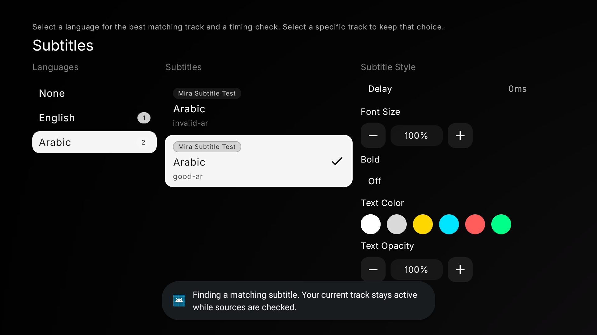

<h1 align="center">Mira</h1>

Your media, with room to breathe.

iPhone · Apple Silicon & Intel Mac · Fire TV

  
  
  
  

<a href="#download">Download</a> · <a href="#inside-mira">Explore</a> · <a href="docs/INSTALL.md">Install</a> · <a href="docs/BUILD-171.md">Latest checks</a> · <a href="docs/RELEASING.md">Build & publish</a>

*Real Mac screenshot from build 155. Catalog artwork depends on your sources; the current Mac uses static poster hover cards.*

## Download

| Device | Release package | Version | Setup |
| --- | --- | --- | --- |
| iPhone | [IPA](https://github.com/4marawan001/Mira/releases/download/v0.5.24/Mira.ipa) | 0.5.24 / 168 | Sign with Sideloadly; iOS 16.1+. |
| Apple Silicon Mac | [ARM64 DMG](https://github.com/4marawan001/Mira/releases/download/v0.5.25/Mira-macOS-arm64.dmg) | 0.5.25 / 169 | macOS 12+. |
| Intel Mac | [Intel DMG](https://github.com/4marawan001/Mira/releases/download/v0.5.25/Mira-macOS-x86_64.dmg) | 0.5.25 / 169 | macOS 12+. |
| Fire TV | [Universal APK](https://github.com/4marawan001/Mira/releases/download/v0.5.27/Mira-FireTV-universal.apk) | 0.5.27 / 171 | Android-based Fire TV, API 24+. |
| iPhone update helper for Mac | [Universal Mac ZIP](https://github.com/4marawan001/Mira/releases/download/v0.5.22/Mira-iPhone-Updates-1.1.1-macOS.zip) | Helper 1.1.1 / 169 | Apple Silicon or Intel; macOS 13+. |

Keep Mira installed when updating, and use the same signing identity to retain local data. Mac packages are ad-hoc signed, without Apple notarization. [Installation guide](docs/INSTALL.md) · [All releases](https://github.com/4marawan001/Mira/releases).

**iPhone 168 is published:** the reviewed lookup, profile-cache and query fixes are in a verified Release IPA, with actual internal version **0.5.24 / 168**. Earlier mislabeled packages remain archived. [Changes and checks](docs/BUILD-168.md).

GitHub’s “Latest” points to the shared Fire TV release, which carries the update manifest for every platform. Platform versions can differ; use the table for downloads.

## Inside Mira

Mira is a personal fork of the open-source Nuvio apps. Cinematic artwork, near-black surfaces and compact poster shelves carry through Home, Search, Saved and details. Profiles stay tucked in Settings; PIN-protected profiles still require unlocking. Genre shortcuts and IMDb Top 250 entry points are available from Home.

Search displays results as add-ons respond. View All keeps the original query and loads later pages on demand. Duplicate detection and repeated-page protection prevent endless repeated results. There is no fixed total-result cap; providers can still omit matches or lack search/pagination support. Person profiles and cast navigation depend on metadata returned by your sources.

*iPhone 168 on the dedicated Debug iPhone 12 mini simulator. The reviewed source is now packaged in the separate Release IPA.*

### Choose playback quality

| Mode | iPhone | Mac | Fire TV |
| --- | --- | --- | --- |
| Low Data | Prefers smaller 720p. | Prefers smaller 1080p. | Prefers smaller 1080p. |
| Balanced | Prefers good 1080p, considering size and codec support. | Prefers compatible 4K within the size budget. | Prefers supported 4K on a capable 4K TV; otherwise 1080p. |
| Highest | Prioritizes hardware compatibility, resolution and disc sources. | Prioritizes compatible resolution and disc/REMUX. | Prioritizes supported resolution and disc/REMUX. |

Mac and TV Balanced use a budget of **40 decimal GB per two hours**, scaled by known runtime. Balanced now considers runtime-scaled compression hints, so a tiny 2 GB two-hour 4K copy no longer wins just for saving space. A substantial encode is preferred when available; short episodes scale down. Unknown-size or oversized copies remain available manually. Hardware checks help rank supplied codec metadata; they do not measure bandwidth or guarantee every HDR mode, codec profile, audio format or container. Playback still validates the real stream when opening it.

### iPhone previews

Select **Settings → Look & feel → Browsing → Videos**, then press and hold a poster. A supplied trailer is preferred. A ready direct stream can provide a muted excerpt from **0:20 to 0:50**, ending earlier for short videos. Videos shorter than 20 seconds start at zero. Unknown duration or unsupported seeking shows an unavailable message. Normal playback and watch progress stay separate from previews.

Mac build 165 removes Videos mode and automatic hover-video playback to reduce decoder work while browsing. Static hover cards remain. TV has no hover-video mode.

### Appearance

Choose an accent color, alternate icon and layout. The default uses Mira’s silver mark and dark surfaces. On iPhone and Mac, the Home logo briefly dances after ten stationary seconds and respects Reduce Motion. TV uses remote focus indicators.

## Fire TV, adapted for your remote

<table><tr>
<td width="50%"></td>
<td width="50%"></td>
</tr></table>

*Home/poster images are build 167; the quality picker is build 170, all in an Android TV emulator. Populated browsing uses a local metadata-only fixture with public Cinemeta artwork. These images do not establish physical-TV performance.*

Build 167 introduced bounded poster decoding, removed duplicate catalog presentation work and avoided live source-menu blur. Focus scrolls when a card needs room. Empty Home retains navigation and setup. Provider responses are serialized to prevent competing autoplay selections. Build 170 raises the Balanced ceiling to 40 GB/two hours, reduces the preference for over-compressed copies, and prevents cached links or early binge groups from bypassing current quality selection. [TV changes and validation](docs/BUILD-167.md).

## Better Arabic and English subtitles

On Fire TV 171, open the subtitle panel and click **Arabic** or **English** to request the best available track. A matching full-dialogue embedded track is preferred. Otherwise Mira considers add-on release names, filenames, frame rate and provider-reported hash matches, validates a few downloads, and tries another if one is broken. Choosing an individual row keeps that exact track.

Subtitle loading no longer restarts when sync analysis begins. Downloads cancel when you switch, recreated views repaint active cues, and repeated synchronization uses original timing instead of compounding corrections. The video buffer stays intact on the sidecar path.

Automatic timing correction needs a suitable embedded subtitle reference and passes confidence checks before applying. It cannot guarantee alignment for every cut or provider file; unsupported MPV/libass paths and missing references are reported. Embedded tracks, manual track selection and timing controls remain available. **202 focused tests passed**, including 25 new matching, Arabic HTTP, cancellation and lifecycle checks. [Checks and remaining TV tests](docs/BUILD-171.md).

*Final signed 171 APK in the TV emulator, using a locally generated video and synthetic subtitle files. The unusable first candidate is skipped. This image does not demonstrate real-film synchronization.*

## Previous quality update

Mac 169 and Fire TV 170 improve Balanced selection while preserving iPhone 168. For a two-hour movie, an 18 GB 4K Blu-ray HEVC encode beats a 2 GB 4K copy; a 39 GB REMUX does not win automatically. The maximum is 40 GB, rather than a target download size.

The new focused checks passed **68 Mac tests and 45 TV tests**, plus a signed TV Release quality-settings remote check. The separate populated-browsing fixture check did not pass setup. [Mac checks](docs/BUILD-169.md) · [TV checks](docs/BUILD-170.md). Physical Insignia playback and sustained frame pacing still need device testing.

## Updates

Mac checks on opening and hourly while running, verifies downloads with SHA-256, then provides **Install & Restart**. Fire TV uses its existing update/install confirmation flow.

The optional Mac helper downloads a verified IPA and opens Sideloadly. Signing refresh and feature installation are separate; Sideloadly may still need you to click Start. The helper now recovers if a platform-only GitHub release temporarily becomes Latest without a manifest, checks cached IPA integrity and internal app version, and prevents downgrading an actually newer cached package.

*Helper 1.1.1, verified on this Mac. It downloads an IPA; it cannot bypass iPhone signing requirements.*

[Live update manifest](https://github.com/4marawan001/Mira/releases/latest/download/mira-updates.json) · [Publishing rules and channel check](docs/RELEASING.md).

## Checks and remaining device testing

The October 14 audit passed **118 iPhone logic checks, 53 Mac checks, 49 Fire TV checks and 26 helper checks**. This includes synthetic pagination beyond 1,000 results, hardware-aware quality ranking, profile cache isolation, update verification and temporary-app Mac installer tests. These are selected regression suites, not a claim that every device path is tested.

Earlier broad suites retain known failures: two vendored TV Media3 tests and five desktop tests recorded in previous reports. Physical Insignia playback/focus, Intel GUI behavior, real-provider iPhone seeking and sustained scrolling performance still need device checks. No measured 60fps or zero-lag claim is made. [Full audit status](docs/AUDIT-2026-10-14.md).

## Source and earlier changes

App source archives and patches are attached to their platform releases. The source repositories contain local changes beyond those archives; the audit and build documents identify the delivered versions. The update helper’s source and checks are in [companion](companion), with a read-only [release channel validator](tools/check-release-channel.py).

[Mac 165](docs/BUILD-165.md) · [iPhone 164](docs/BUILD-164.md) · [TV 167](docs/BUILD-167.md) · [Earlier release history](https://github.com/4marawan001/Mira/releases).

Mira builds on [NuvioMobile](https://github.com/NuvioMedia/NuvioMobile), [NuvioDesktop](https://github.com/NuvioMedia/NuvioDesktop) and [NuvioTV](https://github.com/NuvioMedia/NuvioTV). App source archives retain their upstream licensing and notices. Catalog availability depends on the add-ons you configure; Mira does not host media.
