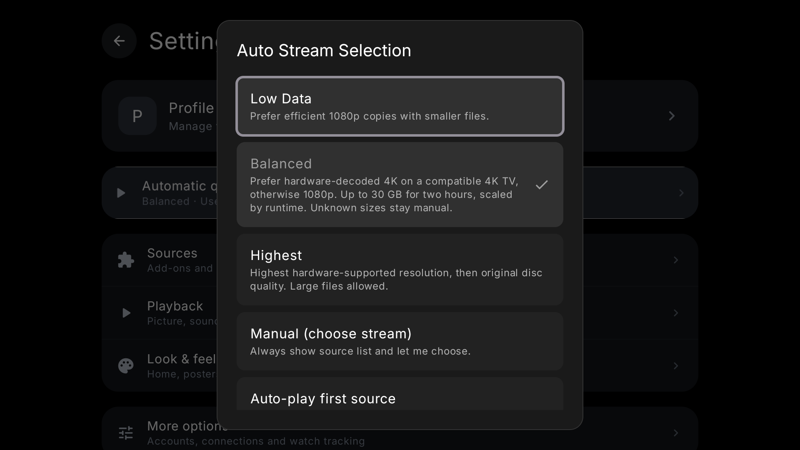

<h1 align="center">Mira</h1>

Your media, with room to breathe.

iPhone · Apple Silicon & Intel Mac · Fire TV

  
  
  
  

<a href="#download">Download</a> · <a href="#inside-mira">Explore</a> · <a href="docs/INSTALL.md">Install</a> · <a href="docs/AUDIT-2026-10-14.md">Latest checks</a> · <a href="docs/RELEASING.md">Build & publish</a>

*Real Mac screenshot from build 155. Catalog artwork depends on your sources; the current Mac uses static poster hover cards.*

## Download

| Device | Release package | Version | Setup |
| --- | --- | --- | --- |
| iPhone | [IPA](https://github.com/4marawan001/Mira/releases/download/v0.5.21/Mira-ios-166.ipa) | 0.5.21 / 166 | Sign with Sideloadly; iOS 16.1+. |
| Apple Silicon Mac | [ARM64 DMG](https://github.com/4marawan001/Mira/releases/download/v0.5.20/Mira-macOS-arm64.dmg) | 0.5.20 / 165 | macOS 12+. |
| Intel Mac | [Intel DMG](https://github.com/4marawan001/Mira/releases/download/v0.5.20/Mira-macOS-x86_64.dmg) | 0.5.20 / 165 | macOS 12+. |
| Fire TV | [Universal APK](https://github.com/4marawan001/Mira/releases/download/v0.5.22/Mira-FireTV-universal.apk) | 0.5.22 / 167 | Android-based Fire TV, API 24+. |
| iPhone update helper for Mac | [Universal Mac ZIP](https://github.com/4marawan001/Mira/releases/download/v0.5.22/Mira-iPhone-Updates-macOS.zip) | Helper 1.1.0 / 168 | Apple Silicon or Intel; macOS 13+. |

Keep Mira installed when updating, and use the same signing identity to retain local data. Mac packages are ad-hoc signed, without Apple notarization. [Installation guide](docs/INSTALL.md) · [All releases](https://github.com/4marawan001/Mira/releases).

**iPhone release correction:** the separate v0.5.23 release contains an IPA whose internal version is **0.5.22 / build 165**. Its title previously implied otherwise. It adds profile/search work but has a lower build number than 166. If you already use that package, keep it installed; do not downgrade solely to match this table. Its lookup changes remain in the working source. [Audit and next-package status](docs/AUDIT-2026-10-14.md).

GitHub’s “Latest” points to the shared Fire TV release, which carries the update manifest for every platform. Platform versions can differ; use the table for downloads.

## Inside Mira

Mira is a personal fork of the open-source Nuvio apps. Cinematic artwork, near-black surfaces and compact poster shelves carry through Home, Search, Saved and details. Profiles stay tucked in Settings; PIN-protected profiles still require unlocking. Genre shortcuts and IMDb Top 250 entry points are available from Home.

Search displays results as add-ons respond. View All keeps the original query and loads later pages on demand. Duplicate detection and repeated-page protection prevent endless repeated results. There is no fixed total-result cap; providers can still omit matches or lack search/pagination support. Person profiles and cast navigation depend on metadata returned by your sources.

*Current iPhone 168 Debug preview. The source fixes are awaiting preview review before a new Release IPA.*

### Choose playback quality

| Mode | iPhone | Mac | Fire TV |
| --- | --- | --- | --- |
| Low Data | Prefers smaller 720p. | Prefers smaller 1080p. | Prefers smaller 1080p. |
| Balanced | Prefers good 1080p, considering size and codec support. | Prefers compatible 4K within the size budget. | Prefers supported 4K on a capable 4K TV; otherwise 1080p. |
| Highest | Prioritizes hardware compatibility, resolution and disc sources. | Prioritizes compatible resolution and disc/REMUX. | Prioritizes supported resolution and disc/REMUX. |

Mac and TV Balanced use a budget of **30 decimal GB per two hours**, scaled by known runtime. Unknown-size or oversized copies remain available manually. Hardware checks help rank supplied codec metadata; they do not measure bandwidth or guarantee every HDR mode, codec profile, audio format or container. Playback still validates the real stream when opening it.

### iPhone previews

Select **Settings → Look & feel → Browsing → Videos**, then press and hold a poster. A supplied trailer is preferred. A ready direct stream can provide a muted excerpt from **0:20 to 0:50**, ending earlier for short videos. Videos shorter than 20 seconds start at zero. Unknown duration or unsupported seeking shows an unavailable message. Normal playback and watch progress stay separate from previews.

Mac build 165 removes Videos mode and automatic hover-video playback to reduce decoder work while browsing. Static hover cards remain. TV has no hover-video mode.

### Appearance

Choose an accent color, alternate icon and layout. The default uses Mira’s silver mark and dark surfaces. On iPhone and Mac, the Home logo briefly dances after ten stationary seconds and respects Reduce Motion. TV uses remote focus indicators.

## Fire TV, adapted for your remote

<table><tr>
<td width="50%"></td>
<td width="50%"></td>
</tr></table>

*Build 167 running in an Android TV emulator. Populated browsing uses a local metadata-only fixture with public Cinemeta artwork. These images do not establish physical-TV performance.*

Build 167 bounds poster decoding, removes duplicate catalog presentation work and avoids live source-menu blur. Focus scrolls when a card needs room. Empty Home retains navigation and setup. Provider responses are serialized to prevent competing autoplay selections. [TV changes and validation](docs/BUILD-167.md).

## Updates

Mac checks on opening and hourly while running, verifies downloads with SHA-256, then provides **Install & Restart**. Fire TV uses its existing update/install confirmation flow.

The optional Mac helper downloads a verified IPA and opens Sideloadly. Signing refresh and feature installation are separate; Sideloadly may still need you to click Start. The helper now recovers if a platform-only GitHub release temporarily becomes Latest without a manifest, checks cached IPA integrity, and prevents downgrading its own newer download.

*Helper 1.1.0, verified on this Mac. It downloads an IPA; it cannot bypass iPhone signing requirements.*

[Live update manifest](https://github.com/4marawan001/Mira/releases/latest/download/mira-updates.json) · [Publishing rules and channel check](docs/RELEASING.md).

## Checks and remaining device testing

The October 14 audit passed **118 iPhone logic checks, 53 Mac checks, 49 Fire TV checks and 21 helper checks**. This includes synthetic pagination beyond 1,000 results, hardware-aware quality ranking, profile cache isolation, update verification and temporary-app Mac installer tests. These are selected regression suites, not a claim that every device path is tested.

Earlier broad suites retain known failures: two vendored TV Media3 tests and five desktop tests recorded in previous reports. Physical Insignia playback/focus, Intel GUI behavior, real-provider iPhone seeking and sustained scrolling performance still need device checks. No measured 60fps or zero-lag claim is made. [Full audit status](docs/AUDIT-2026-10-14.md).

## Source and earlier changes

App source archives and patches are attached to their platform releases. The source repositories contain local changes beyond those archives; the audit document identifies which fixes are awaiting an app package. The update helper’s source and checks are in [companion](companion), with a read-only [release channel validator](tools/check-release-channel.py).

[Mac 165](docs/BUILD-165.md) · [iPhone 164](docs/BUILD-164.md) · [TV 167](docs/BUILD-167.md) · [Earlier release history](https://github.com/4marawan001/Mira/releases).

Mira builds on [NuvioMobile](https://github.com/NuvioMedia/NuvioMobile), [NuvioDesktop](https://github.com/NuvioMedia/NuvioDesktop) and [NuvioTV](https://github.com/NuvioMedia/NuvioTV). App source archives retain their upstream licensing and notices. Catalog availability depends on the add-ons you configure; Mira does not host media.
