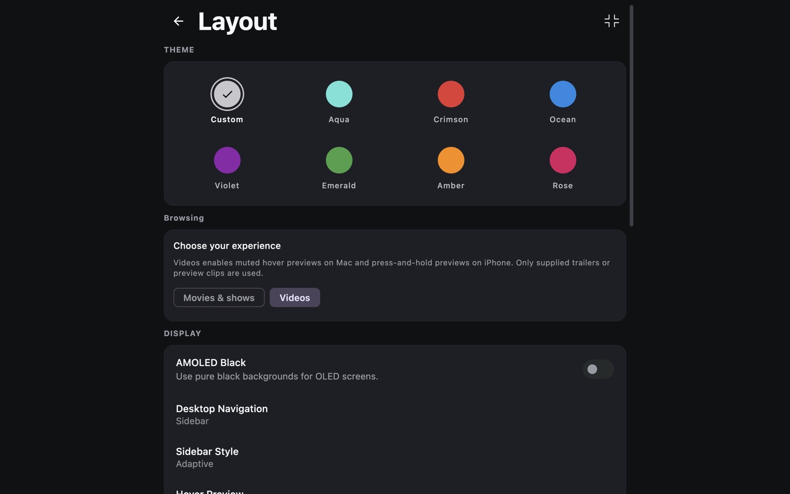

  

<h1 align="center">Mira</h1>

A personal media app with cinematic browsing and a quieter interface.

iPhone · Apple Silicon & Intel Mac · Fire TV

  
  

  <a href="#download">Download</a> · <a href="#inside-mira">Inside Mira</a> · <a href="docs/INSTALL.md">Installation</a> · <a href="docs/BUILD-165.md">Latest changes</a>

Real screenshot from the Mac app, build 155. Artwork and available titles depend on your catalogs.

## Download

Latest releases: **iPhone 0.5.19 · build 164**, **Fire TV 0.5.17 · build 162**, and **Mac 0.5.20 · build 165**. These are Release packages.

| Device | Download | Installation |
| --- | --- | --- |
| iPhone | [IPA](https://github.com/4marawan001/Mira/releases/download/v0.5.19/Mira-ios-164.ipa) | Sign and install with Sideloadly on your Mac. |
| Fire TV | [APK](https://github.com/4marawan001/Mira/releases/download/v0.5.17/Mira-FireTV-universal.apk) | Install on a compatible Android-based Fire TV. Remote controls are supported. |
| Apple Silicon Mac (macOS 12+) | [DMG](https://github.com/4marawan001/Mira/releases/download/v0.5.20/Mira-macOS-arm64.dmg) | Open the disk image and copy Mira to Applications. |
| Intel Mac (macOS 12+) | [DMG](https://github.com/4marawan001/Mira/releases/download/v0.5.20/Mira-macOS-x86_64.dmg) | Open the disk image and copy Mira to Applications. |

Each platform has its own release version. The GitHub Latest badge follows the Fire TV update channel; the table links to the newest build for each device.

[All releases and source downloads](https://github.com/4marawan001/Mira/releases) · [Step-by-step setup](docs/INSTALL.md) · [Fire TV & Mac build 162 checksums](https://github.com/4marawan001/Mira/releases/download/v0.5.17/SHA256SUMS.txt)

## Inside Mira

Mira is a personal fork of the open-source Nuvio apps. Home puts artwork first, with genre shortcuts, IMDb Top 250 entry points and compact poster shelves. Home, Search and Saved use a consistent navigation style on iPhone and Mac; TV adapts browsing for the remote.

Search shows results as individual add-ons respond and loads more on demand. Queries stay intact when opening View All and later pages. Duplicate detection and repeated-page protection keep providers from filling the list endlessly. The app has no fixed total-result cap, but results still depend on each provider's search support and available pages.

Playback preferences include Low Data, Balanced and Highest. On iPhone, Mira checks H.264, HEVC and AV1 hardware support and favors compatible codecs. Balanced favors good 1080p sources for the iPhone 12 mini while reducing the preference for oversized files. Highest then favors resolution and disc sources. On Mac, Low Data targets 1080p and Balanced favors suitable 4K within its size budget. These choices rank the metadata providers return; they do not measure your internet speed or guarantee playback quality.

### Videos on iPhone

On iPhone, open **Settings → Look & feel → Browsing**. Movies & shows is the default. Videos enables muted press-and-hold preview sheets. If no trailer resolves, a ready direct stream previews from 0:20 for up to 30 seconds. Short videos end naturally; videos shorter than 20 seconds start at 0:00. Unknown duration or unsupported seeking displays an unavailable message. Preview availability depends on the provider.

Mac build 165 removes Videos mode and automatic hover-video playback. Mac poster hover cards stay static to avoid video decoder work during browsing. Normal movie playback remains available.

### Make it yours

Choose an accent color, change the app icon, or adjust the browsing layout. The silver icon and dark surfaces carry through the app. On iPhone and Mac, the Home logo does a brief dance after ten stationary seconds and respects Reduce Motion.

Real screenshot from the Mac app, build 155 (appearance settings).

## What's new in Mac build 165

Removed **Videos mode and automatic hover-video playback** from Mac. Existing saved Videos preferences migrate to Movies & shows. Static hover cards remain, while old trailer settings cannot silently start previews.

67 focused checks passed. Apple Silicon and Intel packages are verified; the new app is installed on M1. [Mac 165 changes, checks and remaining device testing](docs/BUILD-165.md).

## What's new in iPhone build 164

Autoplay and recommended sources now consider the iPhone's **hardware decoder support**, along with resolution, file size and source readiness. Low Data keeps its **720p** target; Balanced keeps **1080p**. Highest prioritizes hardware-compatible codecs before resolution and disc source. Software-only copies remain fallbacks, and a slow provider can still return a compatible alternative before selection settles.

115 regression checks passed, including 13 hardware-specific checks. The Debug iPhone 12 mini preview and physical-device arm64 source compilation passed; physical iPhone playback testing remains outstanding. [iPhone 164 details and package verification](docs/BUILD-164.md).

## What's new in Mac build 163

Mac Low Data now prefers smaller **1080p** sources. Balanced still prefers suitable **4K** within its size budget, and Highest prioritizes resolution and disc sources. All three use the Mac's hardware-decoder capabilities when ranking codecs. Equivalent Low Data candidates favor smaller known files; lower resolutions remain fallbacks. The Settings footer now shows the correct Mac version.

80 targeted checks passed. [Mac build 163 details and validation](docs/BUILD-163.md).

## What's new in Mac build 162

- Separate **Apple Silicon and Intel** Release downloads, with architecture-aware updates.
- **Device-local playback preferences:** changing the Mac's quality mode does not change the iPhone's preference.
- **Balanced on Mac:** prefers suitable 4K, with a budget of 30 decimal GB per two hours, scaled to known runtime. Known oversized and unknown-size sources remain available for manual playback. Highest still allows original-quality remuxes.
- **Hardware-aware codec ranking:** checks the Mac's VideoToolbox decoder capabilities. This M1 supports H.264 and HEVC hardware decoding, with no AV1 hardware decoder. Provider metadata and unusual codec profiles can still be imperfect.
- **Less rendering work:** poster browsing avoids a duplicate captured graphics layer per card; hover springs update graphics rather than recomposing each frame. Context menus use the artwork fallback.
- **Startup:** native playback warmup runs off the UI thread, with deferred native-controller loading.

74 targeted regression checks passed. An earlier broad suite exposed five previously reported failures outside these changes. Home scrolling and poster-to-details navigation were checked on M1. The Intel app was smoke-tested under Rosetta; physical Intel testing and measured frame rates remain outstanding. [Mac checks and limitations](docs/BUILD-162.md).

## What's new in Fire TV build 162

- **1:1 iPhone IPA Visual Replica**: Complete overhaul replicating the sleek dark iPhone UI on Fire OS, including `MiraTvHomeHeader` (brand mark + D-pad Search, Saved, Settings), `TvHomeGenreSection` (dark rounded pills with vibrant colored dots), `TvMiraChartSection` (IMDb Top 250 with gold stars), and `MiraTvPosterCard` (fixed 126x189dp cards with 1.05x GPU scaling and crisp 2dp focus ring).
- **60fps Fluidity on Low-End TV Hardware**: Eliminated layout measurement thrashing by replacing dynamic card width animations with GPU-layer hardware scaling. Fixed-size downsampling (252x378) and enabled memory/disk caching for instant poster loads.
- **Background Player Eliminated**: Removed background ExoPlayer instances on poster focus that previously exhausted A53 CPU and video decoder pipelines, replacing them with cinematic static backdrops and direct [ Play ] / [ Details ] actions.
- **Focus & D-Pad Traversal Restored**: Removed broken bottom navigation pill and key interceptors that previously trapped focus and hijacked down/left remote presses. Natural remote navigation from Header -> Hero -> Genres -> Charts -> Continue Watching -> Catalogs.
- **Seamless In-Place Upgrades**: Signed with the official Mira release key under package `app.mira.tv` (`versionCode = 162`, `versionName = "0.5.17"`), upgrading directly over build 160 preserving settings and logins.

[Read Fire TV & Mac build 162 changes and checks](docs/BUILD-162.md).

## What's new in iPhone build 161

- **Deterministic 0:20 Excerpt Timing**: Replaced random excerpt starting points with a fixed, deterministic start at 20,000 ms (0:20). For standard videos, playback previews 0:20–0:50 every time without playing the initial 20 seconds, waiting in real time, or picking a random section.
- **Short-Video Rules & Unavailable Fallback**: Videos between 20s and 50s start at 0:20 and play to end; videos 20s or shorter start at 0:00 and play to end; unknown duration or unsupported seeking displays a clear unavailable message without infinite spinning.
- **Clear Interface Copy**: Removed all "Random excerpt" wording across the app in favor of exact timing indicators (e.g., *"Muted preview · Starts at 0:20 · Up to 30 seconds"*).
- **Preserved Rules**: Press-and-hold previews remain exclusive to Videos browsing mode, trailer clips remain first choice, audio is muted, requests time out and cancel cleanly, and previews never write watch progress.

[Read iPhone build 161 changes and checks](docs/BUILD-161.md) · [Earlier build 158 notes](docs/BUILD-158.md).

## What's new in Mac build 157

- Fixes the updater’s installed-app lookup. Install this DMG once if an older build cannot apply its download.
- Automatic update checks on opening and hourly while Mira stays open.
- Automatic downloads with checksum verification, followed by an Install & Restart button. Playback is not interrupted by a completed download.
- Muted random excerpts in Videos mode when no trailer resolves. Preview requests time out and cancel on scrolling or dismissal.
- Less rendering work during scrolling: image crossfades disabled, card highlights cached, and hover scaling suppressed while scrolling.

[Read build 157 changes and checks](docs/BUILD-157.md) · [Earlier build 155 notes](docs/BUILD-155.md).

## Updates

Mac checks for updates on opening and hourly while Mira is running. New packages download automatically and pass a SHA-256 check before **Install & Restart** becomes available. Installation retains the previous app and preserves settings stored outside the app bundle. Checks stop when Mira is closed. Fire TV keeps its existing APK update flow.

The optional [Mira iPhone Updates helper for Mac](https://github.com/4marawan001/Mira/releases/latest/download/Mira-iPhone-Updates-macOS.zip) checks for a newer IPA and hands it to Sideloadly. iPhone signing refresh remains separate from installing new features.

The [update manifest](https://github.com/4marawan001/Mira/releases/latest/download/mira-updates.json) records each platform's version, build, package size and SHA-256 checksum. Platforms can have different current builds.

## Testing status

These are personal testing builds. Fire TV build 160 passed 109 focused checks and 296 player/autosync package checks with zero failures. Mac build 157 passed 30 focused checks, including real installer replacement and rejection checks in temporary folders. iPhone build 161 passed 102 regression checks and 13 boundary/determinism unit tests on the iOS simulator. Five broader desktop failures from build 155 remain in the Mac repo. Unit tests verify parser, retimer, and selection logic; real-provider excerpt playback, sustained Mac frame rates, and physical television playback quality remain for device testing. See [Fire TV build 160 validation](docs/BUILD-160.md#validation), [iPhone build 161 validation](docs/BUILD-161.md#validation), and [Mac build 157 validation](docs/BUILD-157.md#validation).

The Mac package supports Apple Silicon and is ad-hoc signed. The Fire TV package supports ARMv7 and ARM64 Android/Fire OS devices with Android 7 or later. Platform features differ; Videos mode and the logo dance are excluded from TV.

## Source and credits

Build 155 contains the full source archives, upstream base commits, original licenses and acknowledgements. Release 161 includes [iPhone Release source reconstruction instructions](updates/161/SOURCE.md), with verified patches for iPhone (Release 161), Fire TV (Release 160) and Mac (Release 157). This repository is the download and documentation hub.

Built on [Nuvio Mobile](https://github.com/NuvioMedia/NuvioMobile), [Nuvio Desktop](https://github.com/NuvioMedia/NuvioDesktop), [Nuvio TV](https://github.com/NuvioMedia/NuvioTV) and [nuvio-engine](https://github.com/NuvioMedia/nuvio-engine).

Mira is a personal fork and is not affiliated with Nuvio or Apple. Release assets exclude saved account data and private signing keys. Media artwork belongs to its respective owners.
