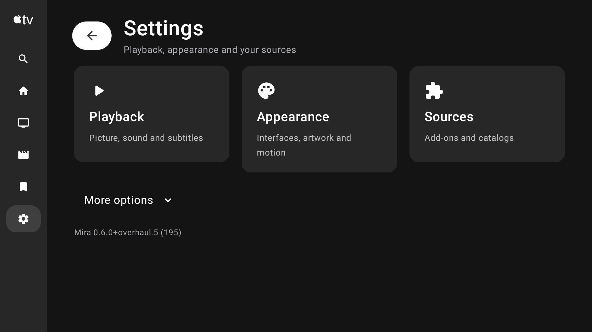
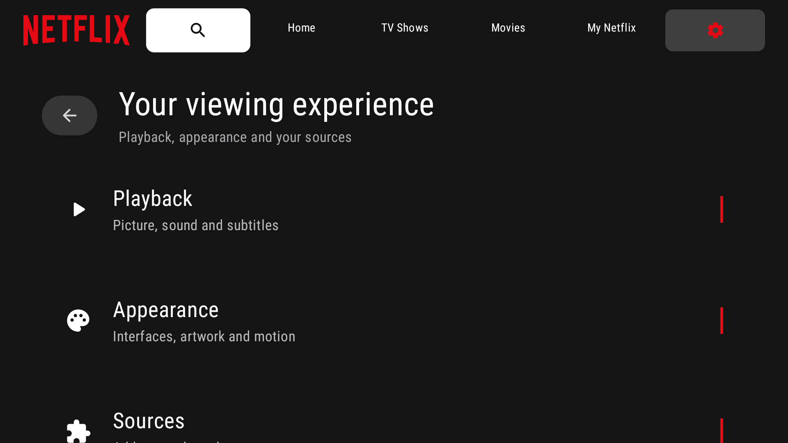

# Mira 0.6.0 overhaul preview

[Download the release](https://github.com/4marawan001/Mira/releases/tag/v0.6.0-preview.1) · [Install](INSTALL-OVERHAUL-PREVIEW.md) · [Validation](VALIDATION-OVERHAUL-PREVIEW.md) · [Source archives and build notes](https://github.com/4marawan001/Mira/releases/download/v0.6.0-preview.1/SOURCE.md)

This manual preview brings five interface designs to Mira's main browsing screens, with builds for Fire TV, Mac, iPhone/iPad and Android phones/tablets.

| Platform | Version / build | Package |
| --- | --- | --- |
| Fire TV | 0.6.0+overhaul.6 / 196 | ARMv7, ARM64 or universal APK |
| Mac | 0.6.0 / 197 | Apple Silicon or Intel DMG |
| iPhone and iPad | 0.6.0 / 194 | One universal IPA, unsigned for Sideloadly |
| Android phone/tablet | 0.6.0 / 195 | Four CPU-specific APKs |

## What changed

- Mira, Apple TV, Netflix, Cinema and Library have different main layouts, navigation, Settings compositions, detail/episode layouts, source pickers and poster actions. Per-profile customization covers continuous corners, artwork, spacing, typography, motion, colors and focus. Some specialist settings and platform dialogs retain shared controls; this is not a verified pixel-for-pixel replica of every screen.
- Wide Apple layouts use a branded sidebar and landscape feature artwork. Mac's main-navigation profile picture is removed; profiles remain in Settings. iPad portrait and landscape layouts use appropriately sized artwork and keep Settings reachable.
- Artwork requests account for display density. Source summaries retain release metadata and provider notices, with resolution and confirmed-cache filters. Existing 4K Balanced targets on Mac/iPad are retained. File labels do not establish decoder or display support.
- TV startup has a bounded Home loading gate. Poster menus open while metadata/library status loads, and a dismissed menu cannot reopen from a late request. Build 196 fixes Menu and long-press handling in genre/IMDb grids.
- Mac 197 replaces the inconsistent media-library bundle with a matched, checksummed runtime and reports source-loading failures instead of leaving the player buffering indefinitely. Events from an old source cannot fail its replacement. Runtime provenance and dependency source instructions accompany the app and source archive.
- Android's updater now selects Mira mobile packages and checks CPU, version/build, package identity and signing identity before installation. Android still asks the user to approve installation.
- Live TV has an empty destination for a future M3U/M3U8 playlist and optional XMLTV guide. Import, channel browsing, guide and sports playback are future work; no playlist is connected.

## Checks and limits

142 selected Mac tests, 140 Android host tests and 56 TV tests passed. The existing iPhone/iPad update helper passed 26 feed/identity/cache checks. Package validation covers identity, version, architecture, ZIP/DMG integrity and applicable signatures. Mac's packaged JVM and native player initialization are checked for both architectures; Intel runs through Rosetta on this Mac.

The physical Insignia Fire TV passed Home startup, remote focus, Settings variants, Live TV, poster Menu/hold, genre-grid menus, details and Back checks. iPhone/iPad Debug 194 was checked in dedicated simulators, including iPad portrait/landscape. Physical iPhone/iPad and Android installation/playback remain unverified.

Mac 197 rendered a cached 1080p HEVC sample through the final release classes/runtime in an isolated local profile. Keyboard pause and Escape/Back were checked. A deliberate unavailable HTTP 404 source produced a clear error, and Go back returned to the source picker. Full mouse-panel interaction, 4K/HDR output and actual subtitle dialogue timing remain unverified.

Fast TV scrolling still drops frames. Matched warm Home runs improved p90 from 38 to 34 ms and p95 from 61 to 53 ms, while reported janky frames increased to 40.67%. These are build 190/195 measurements on one low-memory TV, not a 90% speedup or sustained 60 fps. See PERFORMANCE.json for conditions and grid measurements.

HDR/Dolby Vision output, audio formats and actual English/Arabic dialogue synchronization remain separate hardware checks. Subtitle selection and delay callbacks passed focused checks; a subtitle for a different cut or frame rate can still need another track or manual adjustment. Source availability depends on the provider, even when it advertises a cached file.

See INSTALL.md for each platform and the steps that replace an old Sideloadly refresh entry. SHA256SUMS, PACKAGE-VALIDATION.json, SOURCE.md and source archives accompany the preview. GitHub Latest and the existing stable update feed remain on their earlier releases; installing this preview is a manual choice.

## Shown screens

These physical TV Settings screenshots are from build 195; the layouts are retained in 196. [Download the eight-image preview gallery](https://github.com/4marawan001/Mira/releases/download/v0.6.0-preview.1/Mira-preview-screenshots.zip) for the grid, other Settings designs and phone/iPad Live TV section.
